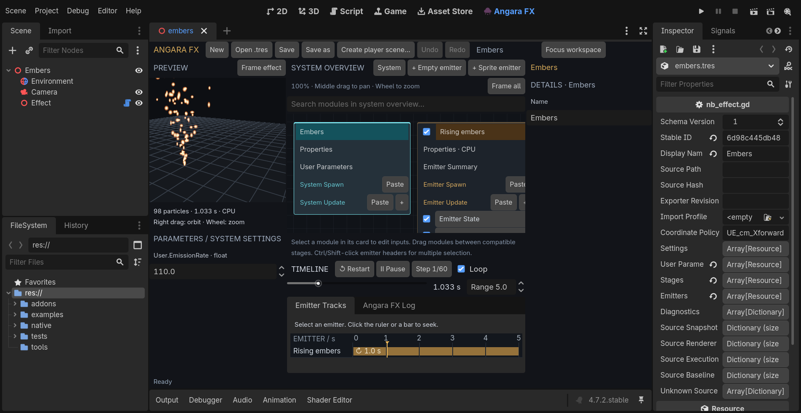

# Angara FX

Angara FX is a modular 3D particle editor and C++ runtime for Godot. Build an effect from emitters, preview it in the editor, and expose the controls your game needs. Two instances can share one effect file and use different emission rates, colors, or other parameters you declare.

Artists who have used Niagara will recognize the spawn and update stages. Angara FX runs entirely inside Godot. Unreal Engine integration belongs to a separate importer.



## Try Embers

Tested with Godot 4.7.2 (standard single-precision build), Windows x86-64, Forward+ and Jolt Physics. The native extension manifest currently targets Windows x86-64. GPU simulation requires a compute-capable rendering device.

1. From a source checkout, [build the native extension](#build-from-source) once.
2. Open [project.godot](project.godot) in Godot and press **F5**. A plume of orange embers rises and curls.
3. Stop the game, select **Angara FX** in the editor, and use **Open .tres** to open [embers.tres](examples/embers/embers.tres). Press **Play** in the preview timeline.
4. Under **Parameters / System Settings**, lower `User.EmissionRate` from `110` to `36` particles per second. Watch the plume thin as the older sparks expire. Use **Save as** to keep your variation alongside the example.

## How an effect works

| Part | What you control |
| --- | --- |
| Effect | A shared `.tres` resource holds emitters, their stages, and default user parameters. |
| Emitter | A stack of modules determines when particles spawn, which attributes they start with, and how they change over time. Available modules include bursts, initial velocity, gravity, drag, curl noise, and size curves. |
| Renderer | Sprite and mesh renderers turn particle attributes into visible geometry. Embers pairs a sprite renderer with a [Godot shader material](examples/embers/ember_material.tres). |
| Player | A 3D scene node runs an effect and holds its per-instance overrides. The native runtime provides CPU simulation and a GPU compute backend for supported modules. |

To create an effect, choose **New**, then **+ Sprite emitter**. The starter stack includes emission, lifetime, and velocity. Select a module to edit its inputs. Use **User Parameters** on the system card to declare a control, then choose it from a compatible module input’s binding menu. The preview timeline lets you pause, restart, or step through the simulation one frame at a time.

Save the effect as a `.tres`, then choose **Create player scene…** to generate a `.tscn` you can drop into a level. Both files use Godot’s standard text format and can be reviewed in a Git diff.

## Control an instance from GDScript

In the [Embers scene](examples/embers/embers.tscn), the player is a child named `Effect`. Its spawn rate is bound to the float parameter `User.EmissionRate`. With this script on the scene root, that instance emits 45 particles per second. Other instances keep their own rates.

```gdscript
extends Node3D

func _ready() -> void:
    $Effect.set_user_parameter_live("EmissionRate", 45.0)
```

The next simulation step reads the new value and existing particles keep their age. Call `$Effect.reset_user_parameter("EmissionRate")` to return to the default stored in the effect.

## Build from source

Install Git, Python 3, CMake 3.24 or later, and Visual Studio 2022 with the **Desktop development with C++** workload and a Windows SDK. Run these commands from the repository root in PowerShell.

```powershell
cmake -S native/niagara_bridge -B build -G "Visual Studio 17 2022" -A x64
cmake --build build --config Release --target niagara_bridge_native --parallel 6
```

CMake fetches the pinned godot-cpp revision and writes `niagara_bridge_native.dll` to `addons/niagara_bridge/native/bin/`. For an existing local checkout of the pinned SDK, add `-DFETCHCONTENT_SOURCE_DIR_GODOT_CPP=<path>` to the first command. The revision is recorded in [CMakeLists.txt](native/niagara_bridge/CMakeLists.txt).

To use Angara FX in your own Godot 4.7 project, copy the built `addons/niagara_bridge` directory, including its DLL, to the same path under your project root. Enable **Angara FX** in **Project Settings → Plugins**. Keep the directory name because saved effects reference resources inside it.

## Verify the build

With Godot 4.7 on your PATH, run these commands from the repository root.

```powershell
godot --editor --import
godot --resolution 960x540 --fixed-fps 60 --script res://tests/core_smoke.gd
python tools/generate_curl_fields.py --check
```

The [smoke test](tests/core_smoke.gd) edits, saves, and reopens an effect, compares CPU and GPU particle positions at three curl-field resolutions, and checks that Embers draws visible particles. Look for `failures 0` on the final line. The [field generator](tools/generate_curl_fields.py) verifies the checked-in text resources. These fields are original to Angara FX, so trajectories can differ from effects authored with Niagara’s baked noise.

## License

Angara FX is released under the [MIT License](LICENSE). The extension links godot-cpp, whose license is included in the [third-party notices](addons/niagara_bridge/native/THIRD_PARTY_NOTICES.txt).
